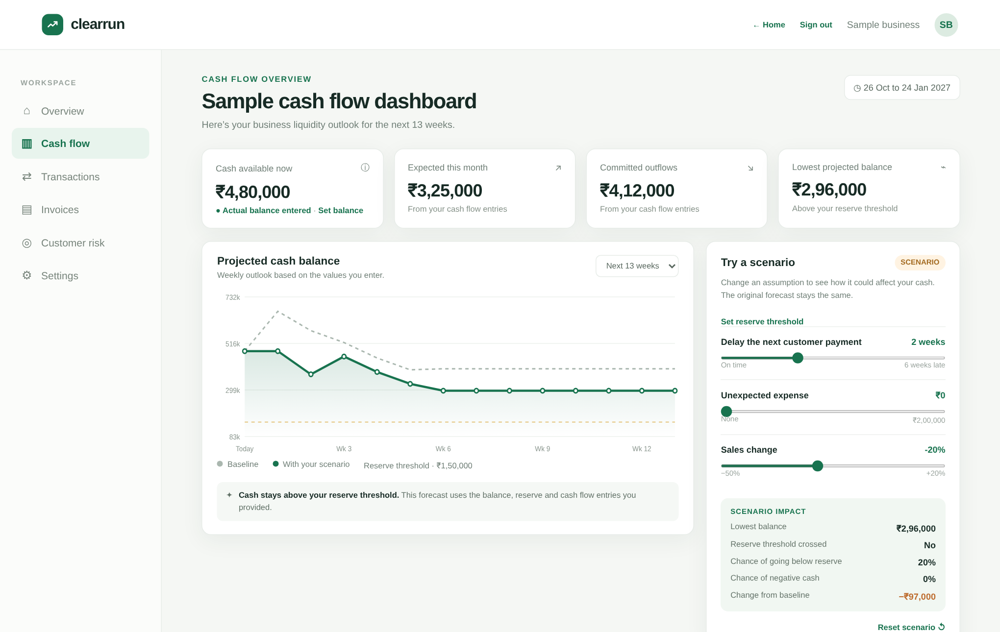

# ClearRun Cash Flow

**Srujana Tech Fest 2026 · Finance theme · Problem statement F-03: predictive cash-flow management for small businesses**

**Live app:** https://clearrun-app3.vercel.app (choose "Explore the dashboard" for the demo; no account needed)
**Project report:** [docs/ClearRun-Project-Report.pdf](docs/ClearRun-Project-Report.pdf)
**More detail:** [Architecture](docs/ClearRun-Architecture.pdf) · [Models](docs/ClearRun-Models.pdf) · [How it addresses F-03](docs/ClearRun-Problem-Statement-F03.pdf) · [Screenshots](docs/screenshots)

Cash flow planning for small Indian businesses: a 13-week forecast, invoices with photo/PDF scanning, a payment reminder ladder (gentle → formal → legal notice), customer credit risk, and shared team workspaces. One `index.html` page plus a small Node.js API; Supabase Postgres stores the data.

## Run it on your computer

1. Install Node.js 20 or newer.
2. In Supabase → SQL Editor, run `supabase/schema.sql`, then `supabase/reminders.sql` (once each).
3. Copy `.env.example` to `.env` and fill in `SUPABASE_URL`, `SUPABASE_SERVICE_ROLE_KEY` and `GOOGLE_CLIENT_ID`.
4. Run `npm run dev` in this folder and open http://localhost:5500 (not the `index.html` file itself).
5. Check http://localhost:5500/api/health. It says exactly which setting is missing, if any.

## Put it online (Vercel)

1. `npx vercel login`, then `npx vercel` in this folder (link to your existing project if asked).
2. Add the same settings: `npx vercel env add SUPABASE_URL --environment production` (repeat for each). Paste the value when asked. If it says "Value is empty", the paste did not work; remove it and add it again.
3. `npx vercel --prod`, then open `https://<your-site>/api/health`. It should show `"ok": true`.

Every `/api/...` request goes to one function (`api/index.js`) through the rewrite in `vercel.json`. Do not add `[...path].js` catch-all files; they do not work outside Next.js.

## Google sign-in

The browser gets the client ID from `/api/config`, which reads `GOOGLE_CLIENT_ID`. Change it in one place (the environment), never in `index.html`. In Google Cloud → Google Auth Platform → Clients → your web client → Authorized JavaScript origins, add every address the app runs on: `http://localhost:5500`, `http://localhost`, and your `https://….vercel.app` site. While the app is in Testing, add each person's Gmail under Audience → Test users.

## Features and where they live

| Feature | Server | Notes |
|---|---|---|
| Accounts, sessions, teams | `lib/api.mjs` | Phone + password or Google. Settings → Team creates invite codes. Saves never overwrite a teammate: a stale save is refused and the browser merges both sets of changes. |
| Invoice scanning | `lib/invoice-extract.mjs` | Needs `GEMINI_API_KEY` or `ANTHROPIC_API_KEY`. Accepts photos and PDFs. Cross-checks the total with the amount in words and with subtotal + GST, validates GSTINs, reads dates day-first, re-reads once if something does not add up, and marks fields to check. |
| Reminder ladder | `lib/reminders.mjs` | Gentle (7 days before, due date) → Formal (7 and 15 days overdue) → Legal notice (30 days overdue). The legal notice is sent automatically only if approved for that invoice; it can always be printed. Daily run at 09:00 IST via `vercel.json` cron. |
| Customer risk | `lib/customer-risk.mjs` | JavaScript port of the team's Python model (same six signals, points, similarity and actions; checked customer by customer against the Python version). History comes from invoices automatically (paid date vs due date, overdue open invoices) plus anything typed in. |
| Shortfall chance | `lib/predictor.mjs` | 1,500 simulated paths; shows the chance of going below the reserve or negative. |

## Reminder emails (optional)

Add `RESEND_API_KEY`, `RESEND_FROM`, `CRON_SECRET` and `REMINDER_TEST_TO` (your own email) and redeploy. While `REMINDER_TEST_TO` is set, every automatic reminder goes to you. Set `REMINDER_LIVE=true` only when you are ready to email customers.

## Tests

| Command | What it runs | Result |
|---|---|---|
| `npm test` | Scanner rules and reminder ladder unit tests | 11/11 and 12/12 passing |
| `npm run test:e2e` | 63 browser and API checks against a stand-in database (needs Playwright with Chromium; no real keys) | 63/63 passing |
| `MOCK_URL=… node tests/google-and-routing.test.mjs` | Google sign-in (with Google's response simulated) and Vercel routing | 13/13 passing |
| `node tests/risk-parity.mjs <dir>` | Builds a dataset to compare the JavaScript risk model with the original Python model | 18/18 customers match |

## Limits

Hackathon MVP. Forecasts and risk scores are estimates from the data entered, not guarantees or financial advice. The legal notice is a template, not legal advice. Before real use: account recovery, audit history, monitoring, backups and a security review.

## Team

See section 15 of the [project report](docs/ClearRun-Project-Report.pdf).
